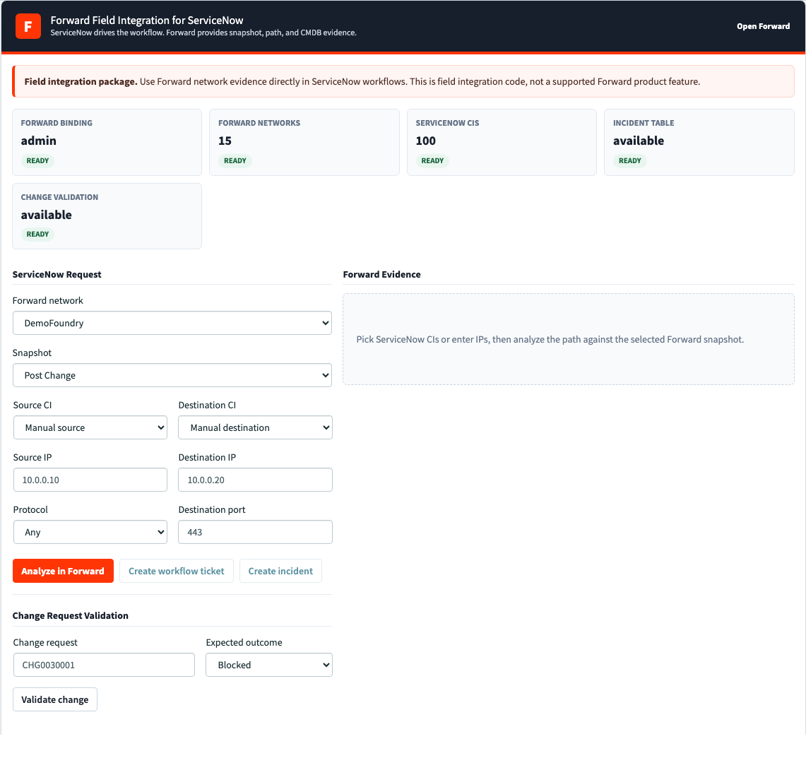
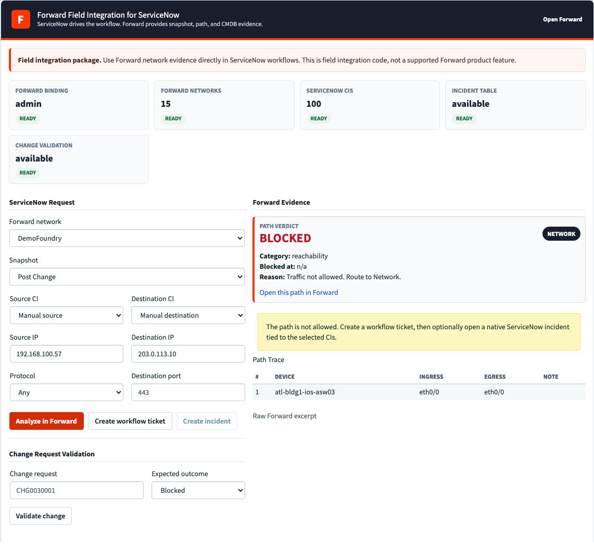

# Forward ServiceNow Field Integration

Forward ServiceNow Field Integration connects ServiceNow workflows with Forward network evidence. ServiceNow remains the workflow system of record; Forward supplies digital-twin path analysis, snapshot evidence, CMDB data, and Change Request validation artifacts.



## Support Boundary

This repository is a Forward field integration package. It is not a supported Forward product, packaged app, or standard platform feature. Treat it as customer-installable integration code that field teams and ServiceNow admins can deploy, audit, operate, and adapt under the customer's normal change-control process.

## What It Installs

- ServiceNow custom task tables for Forward connectivity tickets and Change Request validations.
- A ServiceNow-native change-assurance ledger for idempotent Forward/Dynatrace deployment evidence.
- ServiceNow Script Includes that call the Forward API with bounded timeout and base-URL allowlisting.
- An authenticated Scripted REST endpoint that validates and idempotently ingests bounded Forward/Dynatrace assurance evidence.
- A Service Portal page and widget for path analysis, incident creation, routing, and Change Request validation.
- ServiceNow system properties, routing groups, and tenant bindings.
- A Forward ServiceNow ticketing integration.
- A Forward ServiceNow CMDB integration scoped to one Forward network.
- An org-scoped Forward NQE query for ServiceNow CMDB Netgear CI export.

## Repository Layout

| Path | Purpose |
| --- | --- |
| `servicenow/assets/` | ServiceNow Script Includes, Service Portal widget, client script, server script, and CSS. |
| `servicenow/setup/admin-runbook.md` | ServiceNow admin install, audit, operations, and rollback runbook. |
| `servicenow/setup/forward-install.md` | Forward ticketing and CMDB install guide. |
| `servicenow/setup/install.md` | Manual ServiceNow install checklist. |
| `servicenow/setup/production.md` | Production credential, egress, access-control, and rollback notes. |
| `servicenow/setup/schema.md` | Tables, fields, choices, and system properties. |
| `servicenow/setup/flow-designer.md` | Purchase-free Workflow Studio actions using core Script steps. |
| `docs/change-assurance-blue-sky.md` | ServiceNow-native Forward/Dynatrace change-assurance target workflow and phased plan. |
| `servicenow/nqe/` | Forward NQE source for CMDB export. |
| `scripts/install_servicenow_demo.py` | Idempotent ServiceNow installer. Name retained for compatibility. |
| `scripts/configure_forward_integrations.py` | Idempotent Forward ticketing and CMDB installer. |
| `scripts/audit_servicenow_admin_readiness.py` | Read-only ServiceNow admin readiness audit. |
| `scripts/verify_forward_integrations.py` | Read-only Forward integration verifier, with optional CMDB push proof. |
| `scripts/verify_servicenow_portal.js` | Browser verifier for portal workflow proof. |

## Production-Ready Defaults

Production mode is explicit:

```bash
export SN_PRODUCTION_MODE=1
```

When production mode is enabled:

- ServiceNow tenant bindings must use `u_forward_auth_profile`.
- `FORWARD_USERNAME` and `FORWARD_PASSWORD` fallback credentials are refused.
- direct Forward credential fields in `u_forward_tenant_binding` must stay blank.
- the installer verifies the binding posture before it completes.

Forward calls are additionally constrained by:

- `x_fwd_demo.forward.allowed_base_urls`, default `https://fwd.app/api`
- `x_fwd_demo.forward.request_timeout_ms`, default `30000`

Run this after every install, upgrade, credential rotation, or portal layout edit:

```bash
npm run audit:servicenow
```

The audit is read-only. It fails on missing tables, direct credentials in tenant bindings, duplicate portal widget
instances, public page/widget exposure, inactive Script Includes, bad Forward allowlists, an unbounded worker payload
configuration, direct Table API access to the assurance ledger, or Forward init failures.

For change assurance, the installer also creates role `x_fwd_demo.assurance_writer` and an authenticated POST resource:

```text
/api/now/forward_change_assurance/changes/{change_sys_id}/evidence
```

Assign the writer role only to the bounded Forward-side feedback integration user. The endpoint accepts
`forward-dynatrace-servicenow-change-assurance-evidence/v1`, rejects partial or extended schema documents, topology,
credential content, oversized UTF-8 payloads, and values that cannot fit their persisted fields. The assurance table
does not allow direct Table API web-service access. Replaying the same evidence bundle reuses the original ledger
record, attachment, and work note. The companion
`forward-dynatrace` conductor posts the exact evidence bytes to this endpoint and verifies the returned decision and
idempotency key before accepting the publication receipt. Requests must include
`X-Forward-Dynatrace-SHA256: <evidence-sha256>`; ServiceNow verifies it against the raw request body before writing.
Invalid client evidence returns a bounded `4xx` response; unexpected publication/runtime failures return a generic
`500` so callers can distinguish retryable server failures without receiving internal details.

For purchase-free Flow Designer orchestration, the installer adds `ChangeAssuranceFlowClient` plus bounded Change
Request correlation fields. It uses a core Script step and a Basic Auth Profile rather than the IntegrationHub REST
step. See [servicenow/setup/flow-designer.md](servicenow/setup/flow-designer.md).

## Install Order

Install in this order:

1. Prepare ServiceNow credentials and Forward credentials.
2. Install ServiceNow objects.
3. Audit ServiceNow readiness.
4. Install Forward ticketing and CMDB integrations.
5. Verify Forward integration state.
6. Run an optional browser proof.

## 1. Prepare Credentials

ServiceNow admin credential:

- `SN_INSTANCE_URL`: ServiceNow instance URL, for example `https://example.service-now.com`
- `SN_USERNAME`: ServiceNow implementation/admin user
- `SN_PASSWORD`: ServiceNow implementation/admin password

Forward API credential:

- Forward access key
- Forward secret
- Forward network ID for CMDB sync

For production ServiceNow runtime calls, create a ServiceNow Basic Auth Profile:

1. In ServiceNow, create a Basic Auth Profile, for example `Forward API - Production`.
2. Set profile `username` to the Forward access key.
3. Set profile `password` to the Forward secret.
4. Copy the profile `sys_id`.
5. Use that sys_id as `SN_FORWARD_AUTH_PROFILE_SYS_ID`.

## 2. Install ServiceNow Objects

```bash
export SN_INSTANCE_URL='https://<instance>.service-now.com'
export SN_USERNAME='<implementation-admin>'
export SN_PASSWORD='<password>'
export SN_TENANT_USERNAME='<ServiceNow user who runs the widget>'
export SN_PRODUCTION_MODE=1
export SN_FORWARD_AUTH_PROFILE_SYS_ID='<sys_auth_profile_basic sys_id>'
export FORWARD_BASE_URL='https://fwd.app/api'
export NETWORK_ID='<Forward network id>'

python3 scripts/install_servicenow_demo.py
```

The installer is idempotent. It creates or updates tables, fields, choices, properties, Script Includes, Script Actions, portal page/widget layout, tenant binding, and Change Request validation support.

Expected final lines:

```text
verified portal init: networks=<count> cis=<count>
ServiceNow field integration install complete
Portal URL: https://<instance>.service-now.com/sp?id=connectivity_ticket
```

## 3. Audit ServiceNow Readiness

```bash
npm install
npm run audit:servicenow
```

Expected result:

```text
SUMMARY failures=0 warnings=0 checks=<count>
```

Review [servicenow/setup/admin-runbook.md](servicenow/setup/admin-runbook.md) for the full ServiceNow admin runbook.

## 4. Install Into Forward

The Forward installer configures both ServiceNow ticketing and ServiceNow CMDB sync.

```bash
export FORWARD_BASE_URL='https://fwd.app/api'
export FORWARD_USERNAME='<Forward access key>'
export FORWARD_PASSWORD='<Forward secret>'
export NETWORK_ID='<Forward network id>'

export SN_INSTANCE_URL='https://<instance>.service-now.com'
export SN_USERNAME='<ServiceNow integration user>'
export SN_PASSWORD='<ServiceNow integration password>'

python3 scripts/configure_forward_integrations.py
```

Alternative credential input:

```bash
export FORWARD_TOKEN_FILE='/path/to/forward-access-key.txt'
```

The token file must contain Forward `Access key` and `Secret key` lines.

What the script does in Forward:

1. Verifies the Forward network is reachable and has a processed snapshot.
2. Enables Forward ServiceNow ticketing.
3. If ticketing is already pointed at a different ServiceNow instance, resets that immutable Forward integration and recreates it.
4. Installs or updates the org NQE query:
   `/ServiceNow/Forward Field Integration CMDB Netgear CI`
5. Validates the NQE query against the latest processed snapshot.
6. Reads ServiceNow CMDB schema for `cmdb_ci_netgear`.
7. Maps Forward NQE columns to ServiceNow CMDB fields.
8. Enables Forward ServiceNow CMDB sync for `NETWORK_ID`.

Expected output:

```text
Forward API: https://fwd.app/api
Network ID: <Forward network id>
ServiceNow instance: https://<instance>.service-now.com
Forward network <id> reachable; latest processed snapshot: <snapshot id>
Forward ticketing configured
Forward field integration NQE installed at /ServiceNow/Forward Field Integration CMDB Netgear CI
Forward CMDB configured for network <id> with <count> mapped fields
ServiceNow ticketing and CMDB integration complete
```

If the NQE query already exists and matches the packaged source, the script prints:

```text
Forward field integration NQE already current at /ServiceNow/Forward Field Integration CMDB Netgear CI
```

## 5. Verify Forward

```bash
npm run verify:forward
```

This verifies:

- Forward ServiceNow ticketing endpoint is reachable.
- Forward CMDB configuration exists.
- Forward CMDB status endpoint responds.
- Forward CMDB synchronization history endpoint responds.

Optional side-effect proof:

```bash
export PUSH_CMDB=1
npm run verify:forward
```

Use `PUSH_CMDB=1` only when you intentionally want to trigger a CMDB sync.

## 6. Verify Portal Workflow

Open:

```text
https://<instance>.service-now.com/sp?id=connectivity_ticket
```

Optional browser proof:

```bash
export SN_INSTANCE_URL='https://<instance>.service-now.com'
export SN_USERNAME='<username>'
export SN_PASSWORD='<password>'
export NETWORK_ID='<Forward network id>'
export SN_VERIFY_SRC_IP='192.168.100.57'
export SN_VERIFY_DST_IP='203.0.113.10'

npm run verify:servicenow
```

To include native Change Request validation:

```bash
export SN_VERIFY_CHANGE_NUMBER='CHG0030001'
export SN_VERIFY_EXPECTED_OUTCOME='blocked'
npm run verify:servicenow
```

The verifier writes output to `output/playwright/`, which is intentionally ignored by git.

## Screenshots

### ServiceNow Portal


### Forward Evidence In ServiceNow



## CMDB Query Contract

By default, the Forward CMDB integration installs this org-scoped Forward NQE query:

```text
/ServiceNow/Forward Field Integration CMDB Netgear CI
```

The packaged query is derived from Forward's stock library query:

```text
/External/ServiceNow/CMDB Netgear CI
```

The packaged query converts `Device Type` to a string so ServiceNow `cmdb_ci_netgear.device_type` can map cleanly in stock lab and field environments. Set `USE_STOCK_NQE=1` to use the unmodified Forward stock query; in stock-query mode, the installer omits `Device Type` from the CMDB field map.

## Rollback

ServiceNow:

1. Remove or disable the `connectivity_ticket` portal widget instance.
2. Disable Script Action `AnalyzeTicket`.
3. Disable or rotate the Forward Basic Auth Profile.
4. Preserve ticket and `u_forward_change_validation` records until retention owners approve deletion.
5. Remove custom tables only after retention approval.

Forward:

1. Disable ServiceNow ticketing if it should no longer create or update tickets.
2. Disable ServiceNow CMDB sync if it should no longer push CIs.
3. Keep the org NQE query for auditability, or remove it after confirming no CMDB mapping uses it.
